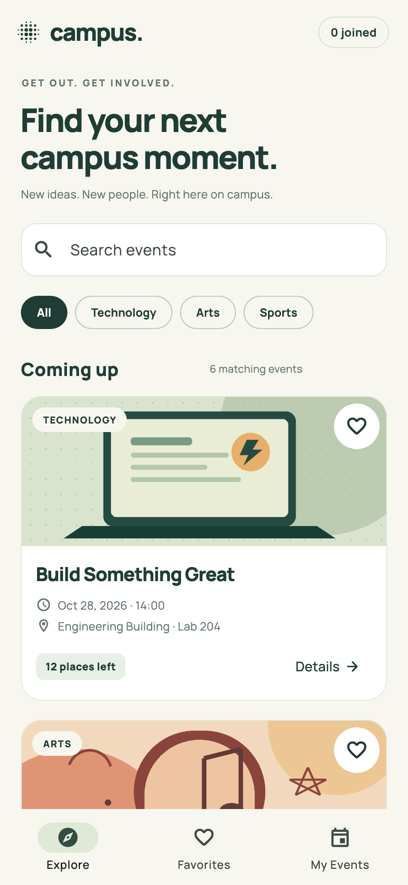
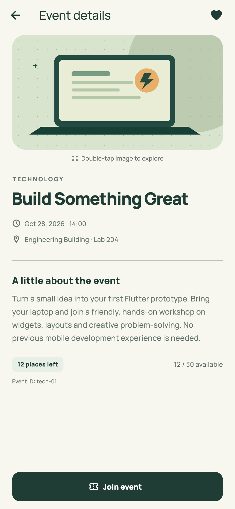
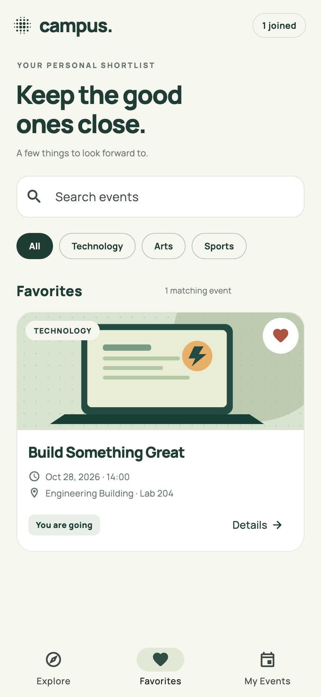
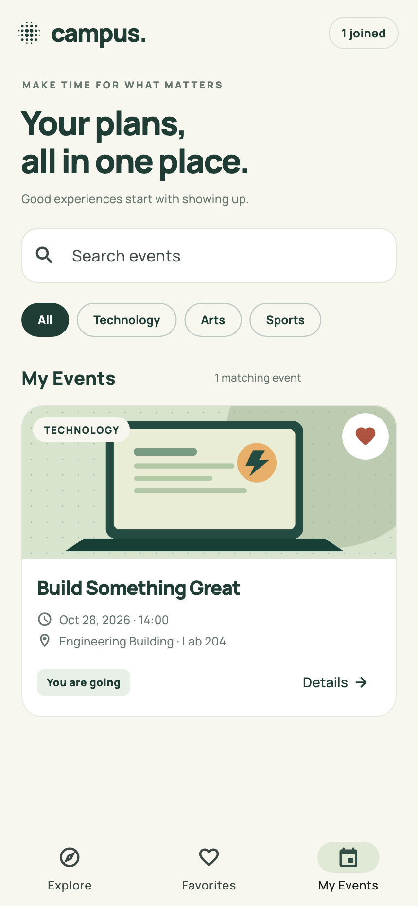
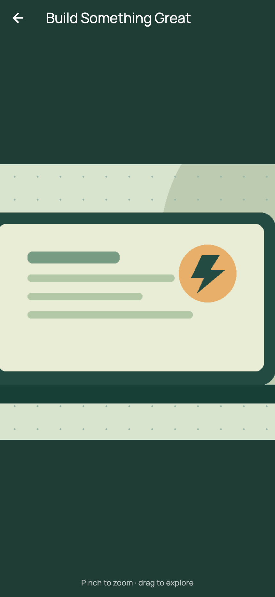
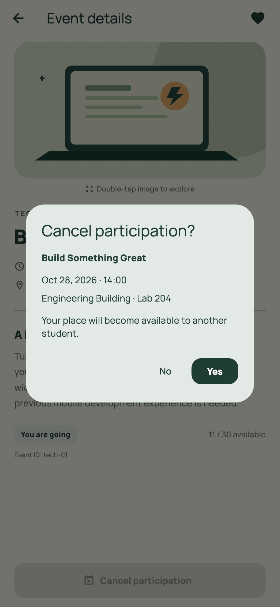
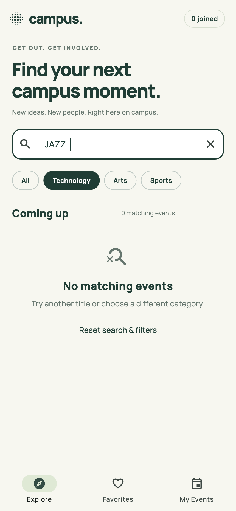
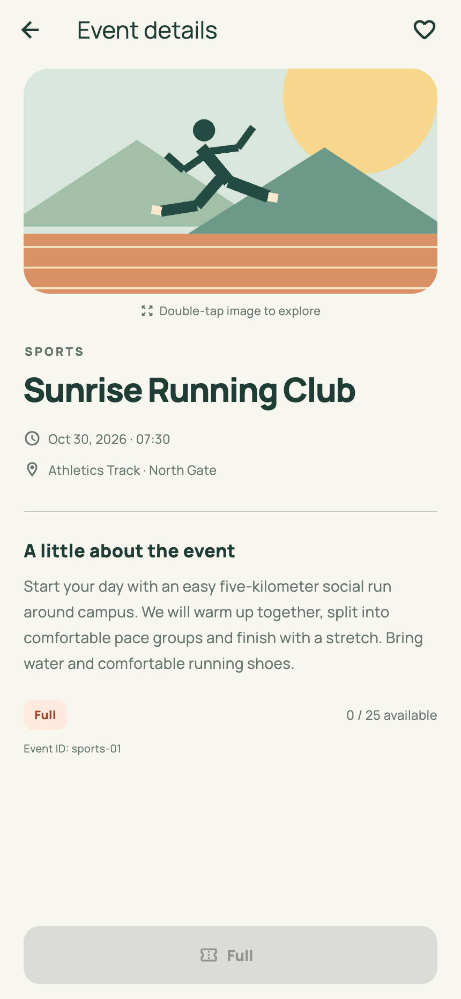

# Campus Event Explorer

BIM493 - Mobile Programming I, Assignment 1, 2026-2027.

An English-language Flutter application for discovering fictional campus events, saving favorites and managing participation. Event data, artwork and fonts are bundled locally. The installed mobile app needs no online service.

## Team and contributions

- **Tarık Ata Kılıç - 40312440132:** provided team and student information, selected English as the application language, coordinated project preparation, reported the browser startup error and confirmed successful startup after the preview server was changed. Tested full-event handling and the last-available-place scenario.
- **Ata Turan - 22652290356:** tested adding/removing favorites, participation and cancellation flows, capacity updates during those flows, screen navigation and image enlargement.

Preparation disclosure: implementation, original illustrations, automated checks and documentation were prepared with coding assistance. The team confirmed completion of the manual checks listed below. These contributions describe review and testing, not independent authorship of assistant-generated code. Android device/emulator validation remains unperformed.

### Completed manual checks

The following checks were reported completed by the team using the browser preview.

**Tarık Ata Kılıç**

- [x] Tested that a full event cannot be joined.
- [x] Tested joining the last available place and cancelling participation afterward.

**Ata Turan**

- [x] Tested adding/removing favorites and consistency across views.
- [x] Tested participation/cancellation flows and the resulting capacity changes.
- [x] Tested screen navigation, image enlargement and Back navigation.

These manual checks supplement the automated checks documented in `VALIDATION.md`; they do not establish Android or iOS device compatibility.

## Toolchain

Use **Flutter 3.47.6 on the Stable channel**. Avoid `flutter upgrade`, which can select a different stable release. Download the required version from the [official SDK archive](https://docs.flutter.dev/install/archive).

Actual `flutter --version` output from the preparation environment on October 23, 2026:

```text
Flutter 3.47.6 • channel stable • https://github.com/flutter/flutter.git
Framework • revision 5fc346839b (3 weeks ago) • 2026-09-30 15:02:49 -0700
Engine • hash b8c8d3d8d5d0095127057f8a29ca8cc53da2167c (revision 692136cb65) (23 days ago) • 2026-09-30 00:56:59.000Z
Tools • Dart 3.13.5 • DevTools 2.60.0
```

Re-checked on macOS (Apple Silicon) on October 25, 2026 with the same SDK:

```text
Flutter 3.47.6 • channel stable • https://github.com/flutter/flutter.git
Framework • revision 5fc346839b (4 weeks ago) • 2026-09-30 15:02:49 -0700
Engine • hash b8c8d3d8d5d0095127057f8a29ca8cc53da2167c (revision 692136cb65) (26 days ago) • 2026-09-30 00:56:59.000Z
Tools • Dart 3.13.5 • DevTools 2.60.0
```

The SDK itself is not included in the source archive.

## Setup and run

Install Flutter 3.47.6 and add its `bin` directory to PATH. For Android, install Android Studio with its Android SDK and start an emulator or connect a device with USB debugging enabled.

```sh
flutter --version
flutter doctor
flutter pub get
flutter devices
flutter run
```

To preview the same Flutter interface in Chrome:

```sh
flutter run -d chrome
```

On the preparation computer, `run.ps1` also locates the downloaded SDK when it is not on PATH:

```powershell
powershell -ExecutionPolicy Bypass -File .\run.ps1
```

The script starts a release-mode local web server. After the build finishes, open `http://127.0.0.1:8766` in Chrome and keep the PowerShell window open. On the preparation computer it prefers the persistent Flutter 3.47.6 SDK under the user's `.cache/tooling` folder, avoiding a different SDK on PATH. Pass `-Device <device-id>` for an Android target.

### Validation and builds

```sh
flutter analyze
flutter test --reporter expanded
flutter build web --release --no-web-resources-cdn
flutter build apk --release
```

The web flag bundles renderer resources instead of fetching them from a CDN. Serve the web build with an HTTP server; `file://` is unsupported. A browser preview needs its local server; the assignment's offline requirement concerns the installed mobile app.

Android SDK tools were unavailable during preparation, so no APK build or Android device test is claimed. An APK is optional for this assignment. iOS builds require macOS and Xcode. Android, iOS and web platform projects are included.

## Features

- Six fictional events across Technology, Arts and Sports, all after the deadline. Every event has a unique ID, title, date/time, venue, description, local image and bounded capacity.
- Title search ignores case and surrounding spaces; category and search work together. Both settings remain active across Explore, Favorites and My Events. Matching-event counts and clear/reset controls are provided.
- Favorites and My Events have helpful empty states. Card and details hearts update the same event immediately across views, without changing participation or capacity.
- Separate details screen shows all fields. Double-tap its image to open a separate full-screen viewer where the image starts enlarged (2x); pinch to zoom up to 4x or out to the whole picture. Normal Back works on both screens.
- Join opens a Yes/No dialog with title, date/time and venue. No or dismissal makes no changes. Yes reserves one place once and shows feedback.
- Cancel participation also requires confirmation. Yes restores one place and removes the event from My Events. No or dismissal keeps the reservation.
- Sunrise Running Club starts full. After Hours: Campus Jazz starts with one place and still permits cancellation after joining the last place.
- A header counter always shows the total number of joined events, independent of active filters.

## Screenshots

Captured directly from the actual Flutter widget renderer at a 430 x 932 logical-pixel viewport, exported at 2x. These are automated UI screenshots, not Android-emulator captures or design mockups. Run `flutter test test/app_test.dart` from the project root to regenerate.

### Explore



### Details



### Favorites



### My Events



### Image viewer, cancel dialog, empty search and full event

| Enlarged image | Cancel dialog | Empty search | Full event |
| --- | --- | --- | --- |
|  |  |  |  |

## Required edge-case checklist

- [x] **Full event:** Sunrise Running Club starts at 0 / 25, is labelled **Full** and its participation button is disabled, so it cannot be joined ([screenshot](screenshots/08-full-event.png)).
- [x] **Cancel dialog:** Cancel participation asks for confirmation and shows the title, date/time and venue. **No** keeps the reservation; **Yes** removes the event from My Events and restores one place ([screenshot](screenshots/06-cancel-dialog.png)).
- [x] **Empty search:** a title/category combination with no matches shows "No matching events" and a reset action on Explore, Favorites and My Events ([screenshot](screenshots/07-empty-search.png)).
- [x] **Last place:** After Hours: Campus Jazz goes from 1 to 0 places after joining, and the student can still cancel and restore it.
- [x] **No duplicates:** joining or cancelling the same event repeatedly never changes capacity twice.
- [x] **Dismissal:** No or tapping outside the join dialog leaves the data unchanged.

## Verification checklist

The model and widget tests cover:

- Unique IDs, category/image counts, valid capacity and dates after the deadline.
- Combined search and category filtering, including case and space handling.
- Full event disabled; last-place join, duplicate prevention and exact capacity restoration.
- Join No and dismissal; cancel No and Yes.
- Favorites updated from details and cards, without affecting participation.
- Shared filters, empty search, empty Favorites and empty My Events.
- Details/image navigation (the viewer opens 2x enlarged), Back and total joined count.
- Narrow-screen layout and larger text.

See `VALIDATION.md` for exact execution results.

## Source organization

- `lib/main.dart`: theme, shared session state, Explore, search, filters and navigation.
- `lib/models/event.dart`: event model, guarded join/cancel methods and combined filtering.
- `lib/data/events.dart`: fresh fictional event data.
- `lib/widgets/event_card.dart`: reusable StatelessWidget card and metadata/availability widgets.
- `lib/screens/event_details.dart`: StatefulWidget details, dialogs and image viewer.
- `assets/`: original images and locally bundled font.
- `test/`: model and widget interaction checks plus screenshot capture.

State updates use simple `setState`, with no advanced state-management library. The root owns event instances; details change the same instance, rebuild locally and notify the root using a callback.

## Asset credits and licenses

- `assets/images/technology.png`, `arts.png`, `sports.png`: original geometric illustrations created programmatically with coding assistance for this project. No third-party photographs. Their reproducible drawing source is `tools/create_artwork.py`; they are covered by the included project license.
- `assets/fonts/Manrope.ttf`: Manrope by the Manrope project authors, from [Google Fonts](https://github.com/google/fonts/tree/main/ofl/manrope). Redistributed under the SIL Open Font License 1.1; original copyright and license are included in `assets/fonts/OFL.txt`.
- Material Icons and Flutter framework assets come from the SDK. See the [Flutter license](https://github.com/flutter/flutter/blob/master/LICENSE) and [Material Icons license](https://github.com/google/material-design-icons/blob/master/LICENSE).
- Launcher icons use an original dot motif generated by `tools/create_icons.py`.

Regenerating artwork needs Python and Pillow, which are development-only tools and not needed by the app.

## Guided research

- [Flutter navigation recipe](https://docs.flutter.dev/cookbook/navigation/navigation-basics)
- [Flutter custom fonts recipe](https://docs.flutter.dev/cookbook/design/fonts)
- [State.setState API](https://api.flutter.dev/flutter/widgets/State/setState.html)

## Scope and limitations

Favorites and participation reset on restart. Dates are fictional campus-local times in Türkiye (UTC+3), displayed in English using 24-hour time; no timezone conversion is performed. There is no login, server, database, GPS, real booking or phone call. Android/iOS real-device behavior remains to be checked by the team.

## Submission

Public repository: https://github.com/krainox02/40312440132_22652290356_Campus_Event_Explorer_HW1

The source ZIP, `40312440132_22652290356_Campus_Event_Explorer_HW1.zip`, carries both student IDs in its name and contains the same files as the repository. It includes platform/configuration files, source, `pubspec.yaml`, `pubspec.lock`, assets, tests, screenshots and documentation. It excludes `build/`, `.dart_tool/`, IDE caches and local SDK paths. Recreate it with `python3 tools/package_submission.py`.

Submit the repository and/or archive link through ESTUOYS by **October 25, 2026, 23:59 (UTC+3)**. Enable instructor link access if using private hosting. The repository was published at the team's request; the ESTUOYS submission itself is made by the team.
